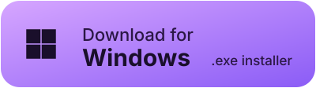
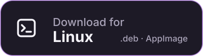
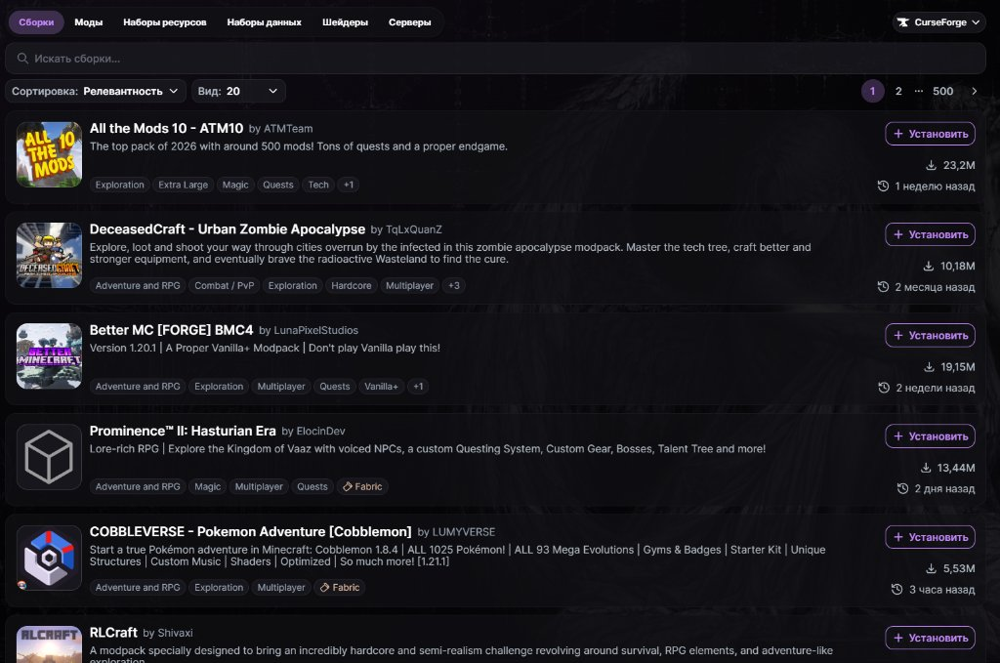
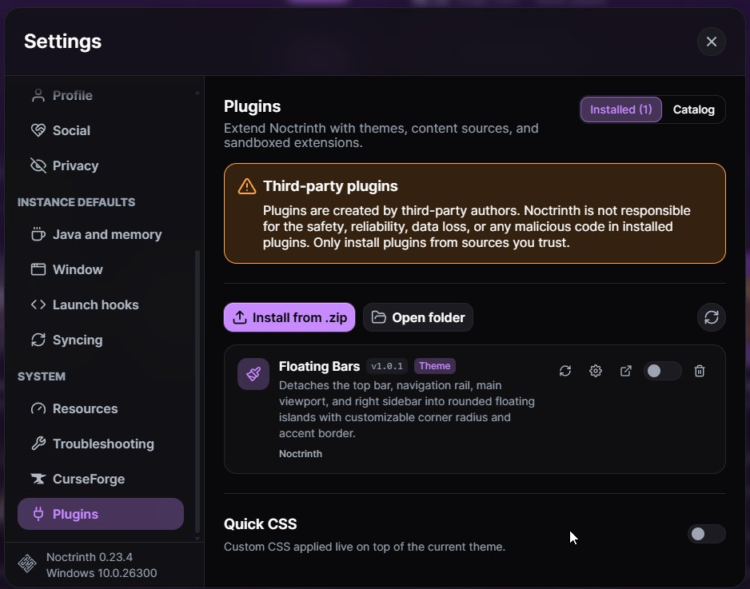
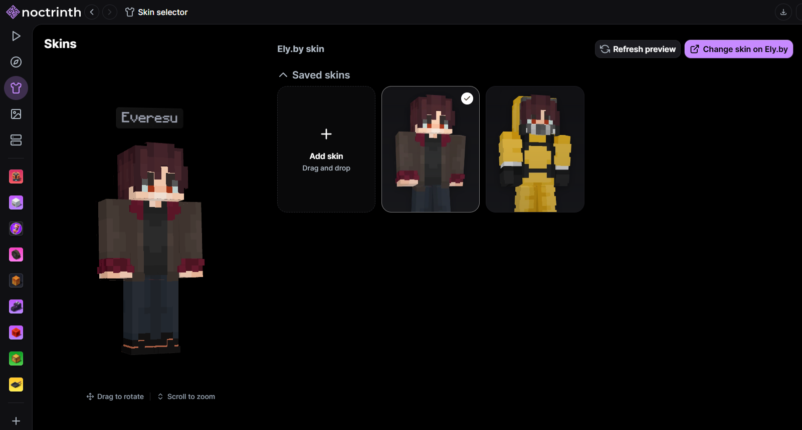
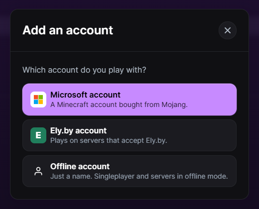
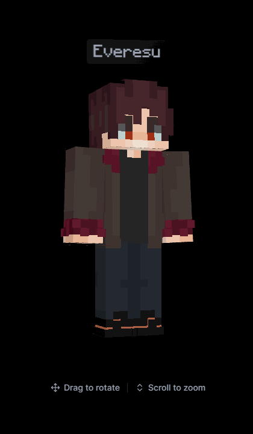
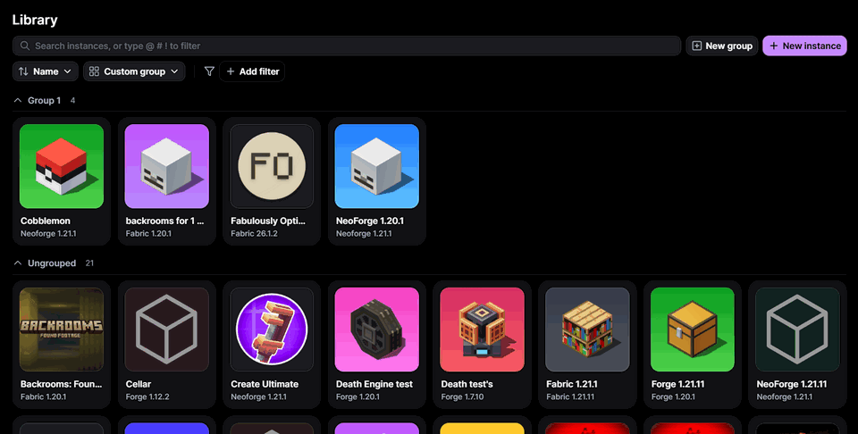
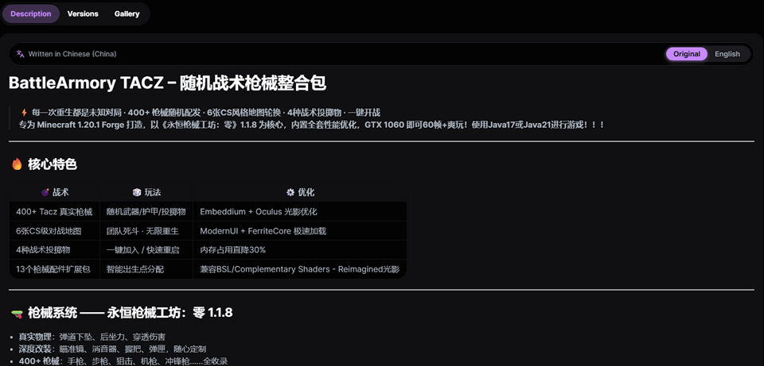
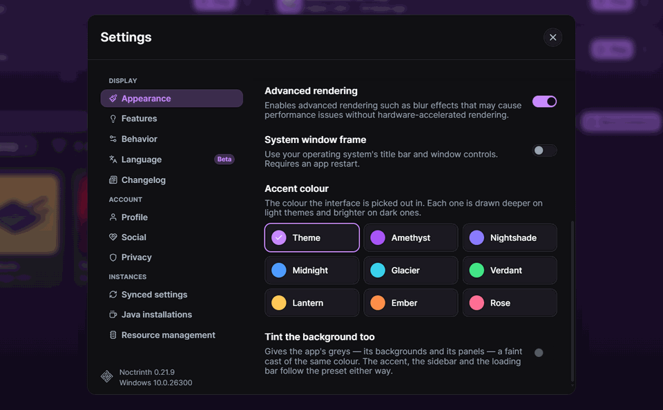

<div align="center">

[](https://github.com/Everelsu/Noctrinth/releases)
[](https://github.com/Everelsu/Noctrinth/releases)
[](apps/app/LICENSE)
[](https://github.com/Everelsu/Noctrinth/stargazers)

**English** · [Русский](README.ru.md)

**Ely.by, offline accounts, CurseForge and plugins, in the Modrinth App you already know.**

🌙 A Modrinth App fork with Ely.by, full CurseForge browsing, offline-server skins and a sandboxed plugin & theme system 🚀

<a href="https://github.com/Everelsu/Noctrinth/releases/latest"></a>
<a href="https://github.com/Everelsu/Noctrinth/releases/latest"></a>
<a href="https://github.com/Everelsu/Noctrinth/releases/latest"></a>

[Website](https://everelsu.github.io/Noctrinth/) · [Plugins](https://everelsu.github.io/Noctrinth/plugins/) · [Plugin Docs](https://everelsu.github.io/Noctrinth/docs/) · [Changelog](https://everelsu.github.io/Noctrinth/changelog/) · [Releases](https://github.com/Everelsu/Noctrinth/releases) · [Issues](https://github.com/Everelsu/Noctrinth/issues) · [Discussions](https://github.com/Everelsu/Noctrinth/discussions) · [Upstream](https://github.com/modrinth/code)

</div>

---

## Screenshots

<div align="center">
<table>
<tr>
<td width="50%"><br/><sub>CurseForge right next to Modrinth in Discover</sub></td>
<td width="50%"><br/><sub>Themes, content sources and extensions in Settings → Plugins</sub></td>
</tr>
<tr>
<td width="62%"><br/><sub>Ely.by skins, worn and uploaded from the launcher</sub></td>
<td width="38%"><br/><sub>Microsoft, Ely.by or just a name</sub></td>
</tr>
</table>
</div>

## Why Noctrinth

The Modrinth App is a genuinely good launcher, but it only knows Microsoft accounts, only browses Modrinth's own catalog, and shows you ads while you browse. If you play on Ely.by or offline servers, install mods and modpacks from CurseForge, customize your launcher, or sit behind a blocked connection, you end up running a second launcher to cover the gaps. Noctrinth covers them in the same app, and follows upstream release for release.

## What Noctrinth adds

### Accounts and skins

- **Ely.by accounts**: sign in through Ely.by's own page, launch through authlib-injector, and browse, wear, upload and delete skins in the same grid the Microsoft account uses
- **Offline accounts**: just a name, for singleplayer and offline-mode servers, wearing the cape that name has on OptiFine, LabyMod, MinecraftCapes or SkinMC
- **Skins for every player**: offline servers send no skins, so everyone is Steve. The launcher looks each player up by name on Ely.by, Mojang and LittleSkin, with no mod on either side
- **Two copies of one instance**: launch a running instance again as another account, each copy with its own console

<div align="center"><br/><sub>The nametag turns with the model like a sign</sub></div>

### CurseForge, instances and content

- **CurseForge in Discover**: switch between Modrinth and CurseForge right on the Discover page to browse, install, update and switch versions of mods, modpacks, resource packs and shaders; restricted files fall back to Modrinth automatically or get picked up from your Downloads folder
- **CurseForge modpack `.zip`, profile codes and `curseforge://` links**: install from an archive, a share code, or the Install button on curseforge.com, with checksum verification, resumable downloads and clean rollback on failure
- **Modrinth App migration & orphan recovery**: bring Modrinth App instances over in a click, or scan the launcher folder to recover instances after a lost database
- **Library search & Quick Search (`Ctrl+K`)**: `@sodium` finds instances with a mod, `#shader` filters by type, `!outdated` by state, and `Ctrl+K` (`⌘K` on macOS) jumps to instances, installed mods, settings tabs or Discover from anywhere
- **Crash diagnosis**: plain-language root-cause analysis in the Logs tab and crash modal, with log search navigation and error/warning counters
- **Modern Java for 1.7.10 & 1.12.2**: one click installs lwjgl3ify or Cleanroom with the launcher-side patches, alongside multiple Java providers (Azul, Temurin, Mojang or mirrors) and a **graphics adapter per Java runtime** on Windows
- **Animated & cropped icons**: crop custom instance icons right in the app, and GIF icons stay animated in the library and survive `.mrpack` exports

<div align="center"><br/><sub><code>@sodium</code> narrows the library to instances that have it</sub></div>

### Plugins, themes and customization

- **Plugin system (`Settings → Plugins`)**: install CSS themes, custom Discover content sources, and sandboxed Web Worker extensions from the built-in SHA-256 verified catalog, `.zip` archives, or `noctrinth://plugin/install/<id>` links — with hot-reload, live logs, and one-click Update All
- **Rich plugin UI & SDK**: plugins can open slide-over HTML panels, register dedicated sidebar pages, show interactive form modals, stream HTTP responses (`fetchStream`, including local LLMs on `localhost`), and safely read/write text configs inside instances
- **Quick CSS & Safe Mode**: prototype custom styles live in `Settings → Plugins → Quick CSS`, and press `Ctrl+Shift+Alt+P` (or pass `--safe-mode`) anytime to pause all plugins and styles
- **Accents, backgrounds and fonts**: pick a preset or any colour on a colour wheel, put a picture, animated GIF or looping MP4/WebM video behind the launcher with adjustable blur and dim, and choose between Inter, system, Minecraft (with Cyrillic) or any installed font

### Around the app

- **Description translation & localized changelogs**: translate project descriptions with Google Translate or DeepL, read both Noctrinth and Modrinth App changelogs in Russian, and use 100% localized UI in Russian, Ukrainian, German, Brazilian Portuguese and Simplified Chinese
- **Touchpad navigation**: two fingers sideways go back and forward, the way Chrome does
- **Collections, followed projects and notifications**: built into the app, with optional toggles to hide sidebar news or Modrinth Hosting
- **Proxy**: one URL (`http://`, `https://`, `socks5://`, `socks5h://`) for every launcher request, for regions where Modrinth is blocked
- **No ads**: Modrinth's ads, consent popup and upsells are switched off

<div align="center">
<table>
<tr>
<td width="50%"><br/><sub>A Chinese description, in English and back</sub></td>
<td width="50%"><br/><sub>Accents applied live as you pick them</sub></td>
</tr>
</table>
</div>

## Get started

### Install

Grab the installer for your platform from the [latest release](https://github.com/Everelsu/Noctrinth/releases/latest):

| Platform | Notes                               |
| -------- | ----------------------------------- |
| Windows  | Installer (NSIS) — x64 and ARM64    |
| macOS    | Universal — Intel and Apple Silicon |
| Linux    | AppImage & `.deb` — x64 and ARM64   |

Updates are signed and delivered automatically through GitHub Releases — no reinstalling.

> [!NOTE]
> Pre-release builds (`0.23.6-beta.1` and similar) are **not** served to the auto-updater. Install them by hand; the app will pick up the matching stable release as a normal update once it ships.

### Bring your instances over

Already on the Modrinth App? Open Noctrinth and a banner offers to import everything it finds. Prefer to choose? **Create instance → Import** lists Modrinth App next to Prism, MultiMC, ATLauncher, GDLauncher and CurseForge.

## Build from source

Requires [Node.js](https://nodejs.org/) ≥ 24.15, [pnpm](https://pnpm.io/), [Rust](https://www.rust-lang.org/tools/install), and the [Tauri prerequisites](https://v2.tauri.app/start/prerequisites/).

```bash
pnpm install
```

Copy the environment template in `packages/app-lib/`, then start the desktop app with hot reload:

```bash
pnpm app:dev
```

Before opening a pull request, run the frontend checks:

```bash
pnpm prepr:frontend:app
```

## Repository layout

This is the upstream Modrinth monorepo, so it carries far more than the launcher — the website, the backend API and the shared libraries all live here. Noctrinth ships the desktop app.

| Path                                | What it is                                                       |
| ----------------------------------- | ---------------------------------------------------------------- |
| `apps/app`                          | Tauri shell — Rust commands, plugin host, window and updater     |
| `apps/app-frontend`                 | Desktop UI (Vue 3), plugin runtime, Noctrinth changelog & i18n   |
| `packages/app-lib`                  | Launcher core — accounts, instances, CurseForge, installs        |
| `packages/ui`                       | Shared Vue component library                                     |
| `apps/frontend`, `apps/labrinth`, … | Modrinth's website and backend, carried from upstream            |

For architecture and infrastructure that isn't fork-specific, the [upstream repository](https://github.com/modrinth/code) remains the reference.

## Relationship with upstream

Noctrinth syncs with [modrinth/code](https://github.com/modrinth/code) and pins its version to upstream's exactly: when Modrinth is on `0.23.5`, so is Noctrinth. Where both sides implement the same thing, upstream's version wins and the fork's is dropped. That is how the fork's shared `options.txt` profile, screenshots tab and download cache went: upstream's settings sync, Screenshots page and content store do the same jobs better.

A fix between upstream releases ships as a micropatch (`0.23.5+1`), which installs already on that version take as a normal update. Test builds ship as pre-releases (`0.23.6-beta.1`), which sort above the current stable and below the next one, so testers roll onto the real release the moment it lands.

## Contributing

Bug reports, plugins and pull requests are welcome — [open an issue](https://github.com/Everelsu/Noctrinth/issues) or read the [Plugin Docs](https://everelsu.github.io/Noctrinth/docs/) to start.

Found a bug that isn't Noctrinth-specific? It belongs [upstream](https://github.com/modrinth/code/issues); fixing it there means everyone gets it, and it reaches this fork on the next sync.

If Noctrinth helped you, [give it a star](https://github.com/Everelsu/Noctrinth/stargazers).

## License

The desktop app is licensed under [GPL-3.0](apps/app/LICENSE). Other packages carry their own licenses — see the `LICENSE` file in each, and [COPYING.md](COPYING.md) for details.

Modrinth branding is the property of Rinth, Inc. and is not used here; Noctrinth ships its own. Noctrinth is an independent fork and is not affiliated with or endorsed by Rinth, Inc.
