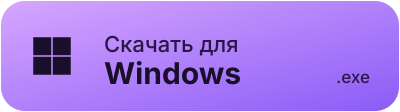
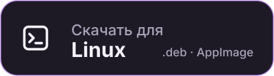
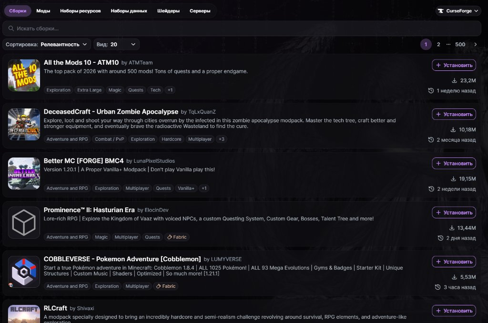
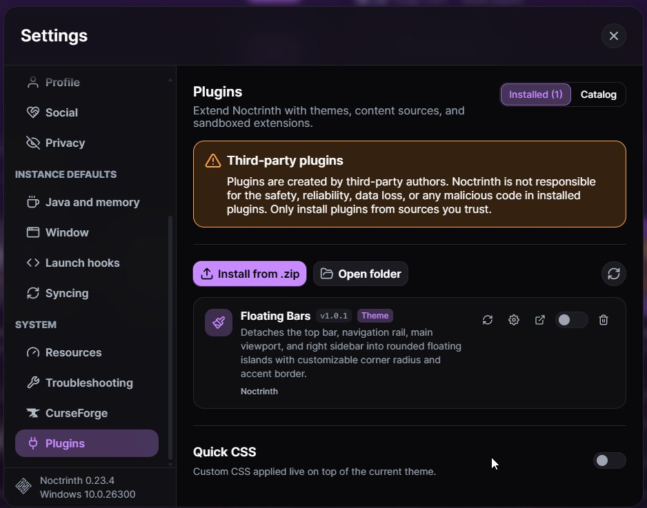
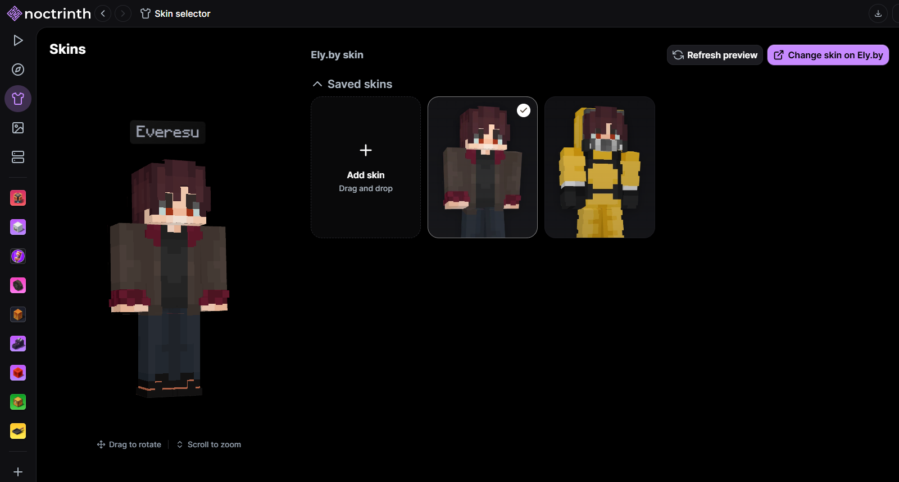
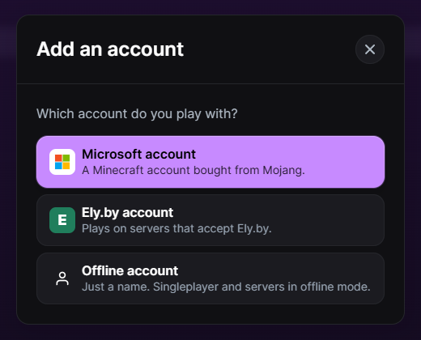
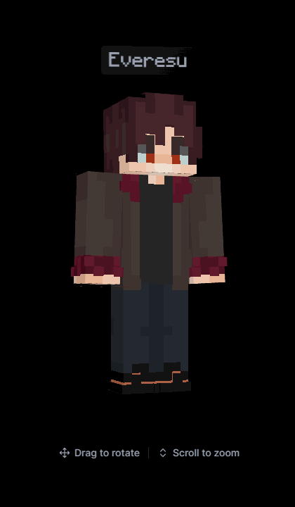
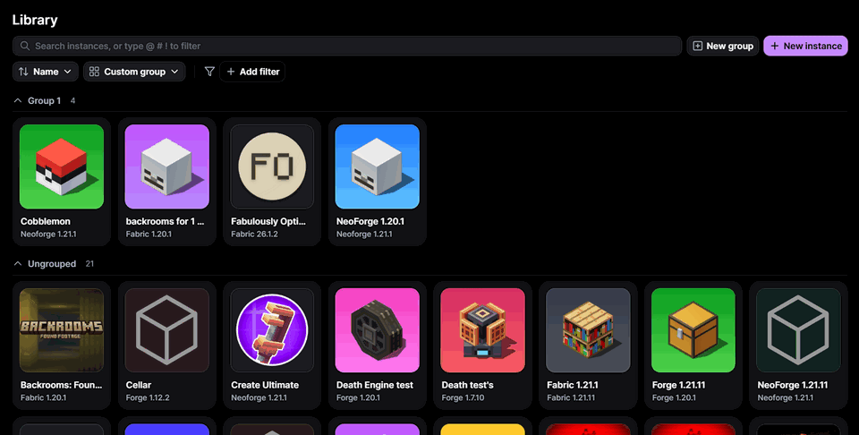
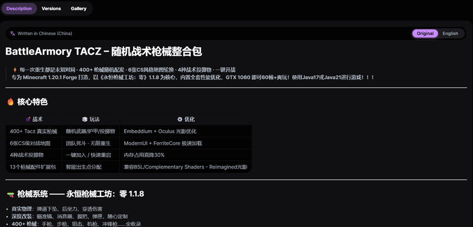
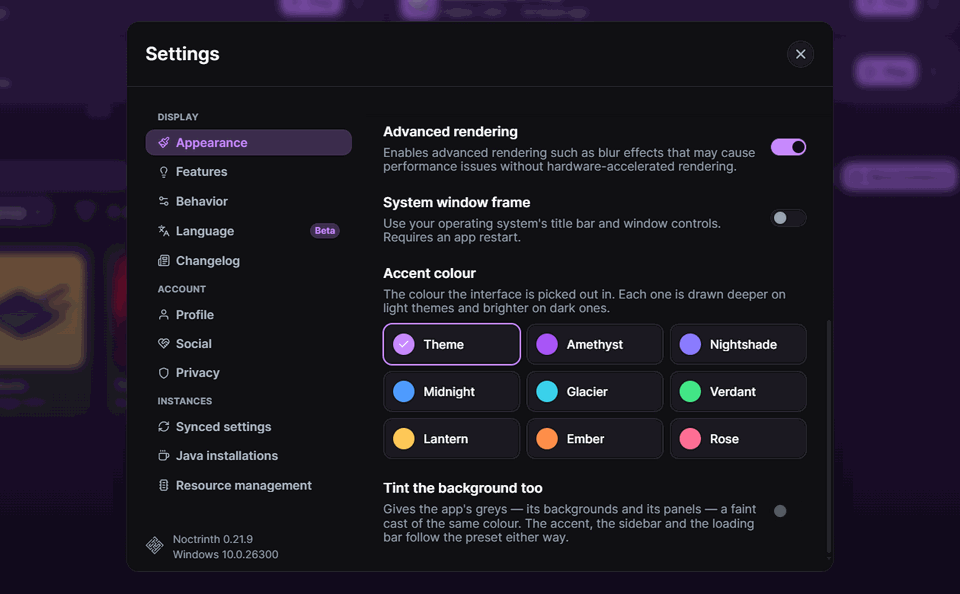

<div align="center">

[](https://github.com/Everelsu/Noctrinth/releases)
[](https://github.com/Everelsu/Noctrinth/releases)
[](apps/app/LICENSE)
[](https://github.com/Everelsu/Noctrinth/stargazers)

[English](README.md) · **Русский**

**Ely.by, офлайн-аккаунты, CurseForge и плагины — в том же Modrinth App, к которому ты привык.**

🌙 Форк Modrinth App с поддержкой Ely.by, полноценным каталогом CurseForge, скинами на офлайн-серверах и системой плагинов и тем 🚀

<a href="https://github.com/Everelsu/Noctrinth/releases/latest"></a>
<a href="https://github.com/Everelsu/Noctrinth/releases/latest"></a>
<a href="https://github.com/Everelsu/Noctrinth/releases/latest"></a>

[Сайт](https://everelsu.github.io/Noctrinth/) · [Плагины](https://everelsu.github.io/Noctrinth/plugins/) · [Документация плагинов](https://everelsu.github.io/Noctrinth/docs/) · [Список изменений](https://everelsu.github.io/Noctrinth/changelog/) · [Релизы](https://github.com/Everelsu/Noctrinth/releases) · [Issues](https://github.com/Everelsu/Noctrinth/issues) · [Обсуждения](https://github.com/Everelsu/Noctrinth/discussions) · [Оригинал](https://github.com/modrinth/code)

</div>

---

## Скриншоты

<div align="center">
<table>
<tr>
<td width="50%"><br/><sub>CurseForge прямо рядом с Modrinth в «Исследовании»</sub></td>
<td width="50%"><br/><sub>Темы, источники контента и расширения в «Настройки → Плагины»</sub></td>
</tr>
<tr>
<td width="62%"><br/><sub>Скины Ely.by — надеть и загрузить прямо из лаунчера</sub></td>
<td width="38%"><br/><sub>Microsoft, Ely.by или просто ник</sub></td>
</tr>
</table>
</div>

## Зачем нужен Noctrinth

Modrinth App — действительно хороший лаунчер, но он умеет входить только через Microsoft, ищет контент только на самом Modrinth и показывает рекламу. Если ты играешь через Ely.by или на офлайн-серверах, ставишь моды и модпаки с CurseForge, хочешь настроить интерфейс под себя или сидишь за заблокированным подключением, приходится держать второй лаунчер ради этих пробелов. Noctrinth закрывает их в том же приложении и идёт за оригиналом релиз в релиз.

## Что добавляет Noctrinth

### Аккаунты и скины

- **Аккаунты Ely.by** — вход через страницу самого Ely.by, запуск через authlib-injector; скины можно смотреть, надевать, загружать и удалять в той же сетке, что и у аккаунта Microsoft
- **Офлайн-аккаунты** — просто ник, для одиночной игры и офлайн-серверов; на нём виден плащ, который у этого ника есть в OptiFine, LabyMod, MinecraftCapes или SkinMC
- **Скины для всех игроков** — офлайн-серверы не передают скины, и все ходят Стивами; лаунчер ищет каждого по нику у Ely.by, Mojang и LittleSkin, без модов с обеих сторон
- **Две копии одной сборки** — запуск уже запущенной сборки вторым аккаунтом, у каждой копии своя консоль

<div align="center"><br/><sub>Ник поворачивается вместе с моделью, как табличка</sub></div>

### CurseForge, сборки и контент

- **CurseForge в «Исследовании»** — переключение между Modrinth и CurseForge прямо над поиском: установка, проверка обновлений и смена версий модов, модпаков, ресурспаков и шейдеров; закрытые для лаунчеров файлы автоматически подбираются с Modrinth или подхватываются из папки «Загрузки»
- **Модпаки CurseForge из `.zip`, коды профилей и ссылки `curseforge://`** — установка из архива, по коду профиля или кнопке Install на сайте CurseForge, с проверкой контрольных сумм, докачкой и чистым откатом при ошибке
- **Миграция из Modrinth App и восстановление сборок** — перенос сборок в один клик или сканирование папки лаунчера, если база данных потерялась
- **Язык поиска и быстрый поиск (`Ctrl+K`)** — `@sodium` находит сборки с модом, `#shader` фильтрует по типу, `!outdated` по состоянию, а `Ctrl+K` (`⌘K` на macOS) мгновенно переходит к сборкам, модам, вкладкам настроек или поиску из любого места
- **Диагностика крашей** — понятный разбор причины сбоя прямо во вкладке «Журнал» и в окне вылета, плюс поиск по логу с навигацией по совпадениям и счётчиками ошибок
- **Современная Java для 1.7.10 и 1.12.2** — установка lwjgl3ify или Cleanroom вместе с патчами лаунчера в один клик, выбор провайдера Java (Azul, Temurin, Mojang или зеркала) и **отдельная видеокарта для каждой Java** на Windows
- **Обрезка и анимация иконок** — интерактивная обрезка пользовательских иконок, а GIF остаётся анимированным в библиотеке и переживает экспорт в `.mrpack`

<div align="center"><br/><sub><code>@sodium</code> оставляет в библиотеке только сборки с ним</sub></div>

### Плагины, темы и кастомизация

- **Система плагинов (`Настройки → Плагины`)** — CSS-темы, сторонние источники для «Исследования» и изолированные расширения в Web Worker с установкой из проверенного по SHA-256 каталога, из `.zip` или по ссылкам `noctrinth://plugin/install/<id>`, горячей перезагрузкой, логами и кнопкой «Обновить все»
- **Гибкий UI и SDK для плагинов** — выдвижные HTML-панели, отдельные страницы в левом сайдбаре, интерактивные формы в модалках, потоковый HTTP (`fetchStream`, включая локальные ИИ на `localhost`) и безопасная работа с текстовыми конфигами внутри сборок
- **Quick CSS и безопасный режим** — живой редактор собственных стилей поверх темы и мгновенная пауза всех плагинов по `Ctrl+Shift+Alt+P` (или флагу `--safe-mode`)
- **Акценты, фоны и шрифты** — готовые пресеты или любой цвет на цветовом круге, картинка, GIF или зацикленное MP4/WebM-видео на фоне лаунчера с настройкой размытия и затемнения, а также выбор шрифта (Inter, системный, Minecraft с кириллицей или любой установленный на ПК)

### Вокруг приложения

- **Перевод описаний и русские списки изменений** — перевод описаний через Google Translate или DeepL с возвратом к оригиналу, ченджлоги Noctrinth и Modrinth App на русском и 100% локализация интерфейса (русский, украинский, немецкий, португальский и китайский)
- **Жесты тачпада** — два пальца вбок листают назад и вперёд, как в Chrome
- **Коллекции, отслеживаемые проекты и уведомления** — прямо в приложении, с возможностью скрыть новости в сайдбаре или кнопку Modrinth Hosting
- **Прокси** — один URL (`http://`, `https://`, `socks5://`, `socks5h://`) для всех запросов лаунчера, для регионов, где Modrinth заблокирован
- **Без рекламы** — реклама, окно согласия и допродажи Modrinth отключены

<div align="center">
<table>
<tr>
<td width="50%"><br/><sub>Китайское описание — по-английски и обратно</sub></td>
<td width="50%"><br/><sub>Акценты применяются сразу по клику</sub></td>
</tr>
</table>
</div>

## Начало работы

### Установка

Возьми установщик для своей платформы из [последнего релиза](https://github.com/Everelsu/Noctrinth/releases/latest):

| Платформа | Примечание                                |
| --------- | ----------------------------------------- |
| Windows   | Установщик (NSIS) — x64 и ARM64           |
| macOS     | Универсальный — Intel и Apple Silicon     |
| Linux     | AppImage и `.deb` — x64 и ARM64           |

Обновления подписаны и доставляются автоматически через GitHub Releases — переустанавливать не нужно.

> [!NOTE]
> Пре-релизные сборки (`0.23.6-beta.1` и подобные) **не** раздаются авто-обновлением. Ставь их вручную; при выходе соответствующего стабильного релиза приложение подхватит его как обычное обновление.

### Перенос инстансов

Уже на Modrinth App? Открой Noctrinth, и баннер предложит импортировать всё найденное. Хочешь выбрать сам? **Создать инстанс → Импорт** покажет Modrinth App рядом с Prism, MultiMC, ATLauncher, GDLauncher и CurseForge.

## Сборка из исходников

Нужны [Node.js](https://nodejs.org/) ≥ 24.15, [pnpm](https://pnpm.io/), [Rust](https://www.rust-lang.org/tools/install) и [зависимости Tauri](https://v2.tauri.app/start/prerequisites/).

```bash
pnpm install
```

Скопируй шаблон окружения в `packages/app-lib/`, затем запусти десктоп-приложение с горячей перезагрузкой:

```bash
pnpm app:dev
```

Перед тем как открыть pull request, прогони проверки фронтенда:

```bash
pnpm prepr:frontend:app
```

## Структура репозитория

Это монорепозиторий оригинального Modrinth, поэтому в нём куда больше, чем лаунчер — здесь же сайт, backend API и общие библиотеки. Noctrinth поставляет именно десктоп-приложение.

| Путь                                | Что это                                                       |
| ----------------------------------- | ------------------------------------------------------------- |
| `apps/app`                          | Оболочка Tauri — Rust-команды, хост плагинов, окно и апдейтер |
| `apps/app-frontend`                 | UI лаунчера (Vue 3), рантайм плагинов, ченджлог и переводы    |
| `packages/app-lib`                  | Ядро лаунчера — аккаунты, сборки, CurseForge, установки       |
| `packages/ui`                       | Общая библиотека Vue-компонентов                              |
| `apps/frontend`, `apps/labrinth`, … | Сайт и backend Modrinth, перенесены из оригинала              |

Для архитектуры и инфраструктуры, не специфичной для форка, справочником остаётся [оригинальный репозиторий](https://github.com/modrinth/code).

## Отношения с оригиналом

Noctrinth синхронизируется с [modrinth/code](https://github.com/modrinth/code) и привязывает свою версию к версии оригинала один в один: если у Modrinth `0.23.5`, у Noctrinth тоже `0.23.5`. Там, где обе стороны реализуют одно и то же, побеждает вариант оригинала, а вариант форка удаляется. Так ушли общий профиль `options.txt`, своя вкладка скриншотов и свой кэш загрузок: синхронизация настроек, страница «Скриншоты» и хранилище контента из оригинала делают то же самое лучше.

Исправление между релизами оригинала выходит микропатчем (`0.23.5+1`) — установки на этой версии получают его как обычное обновление. Тестовые сборки выходят пре-релизами (`0.23.6-beta.1`), которые сортируются выше текущего стабильного релиза и ниже следующего, так что тестеры сразу переходят на настоящий релиз, как только он выходит.

## Участие в разработке

Баг-репорты, плагины и pull request'ы приветствуются — начни с [открытия issue](https://github.com/Everelsu/Noctrinth/issues) или загляни в [документацию по плагинам](https://everelsu.github.io/Noctrinth/docs/).

Нашёл баг, который не специфичен для Noctrinth? Ему место [в оригинале](https://github.com/modrinth/code/issues) — исправление там получат все, и оно придёт в этот форк при следующей синхронизации.

Если Noctrinth оказался полезен, [поставь звезду](https://github.com/Everelsu/Noctrinth/stargazers).

## Лицензия

Десктоп-приложение распространяется под [GPL-3.0](apps/app/LICENSE). У остальных пакетов свои лицензии — см. файл `LICENSE` в каждом из них и [COPYING.md](COPYING.md) для подробностей.

Брендинг Modrinth принадлежит Rinth, Inc. и здесь не используется — у Noctrinth свой. Noctrinth — независимый форк, не связанный с Rinth, Inc. и не одобренный ею.
